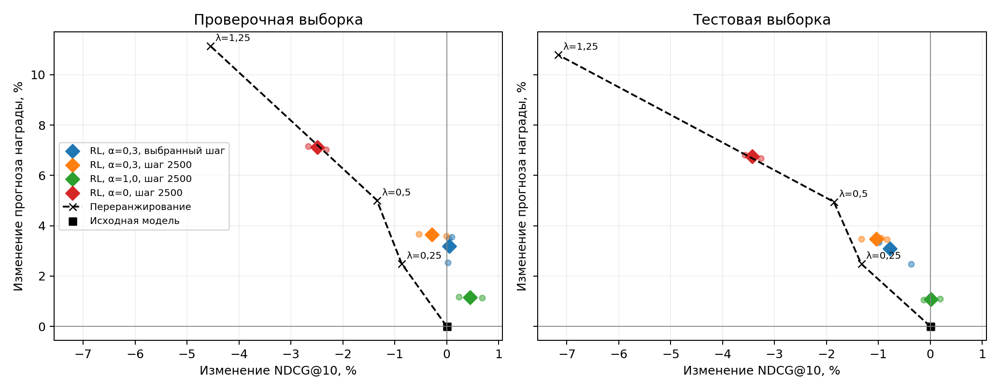

# RL-дообучение последовательной рекомендательной модели

Небольшое исследование на KION: GPT-2 предсказывает следующий фильм по истории
просмотров, а обучение с подкреплением направляет рекомендации к более высокому
прогнозу доли просмотра. Проверяем, как при этом меняются релевантность,
разнообразие и генерация нескольких объектов подряд.

**Основной результат:** выбранный по проверочной выборке вариант RL повышает
прогноз награды на **3,08%** на тестовой выборке при снижении **NDCG@10 на 0,78%**.
Результат усреднен по трем случайным запускам. Модель награды уступает простому
среднему по объекту, поэтому рост ее прогноза не доказывает улучшения
пользовательского опыта.

## Результат на тестовой выборке

| Метод | NDCG@10 | Recall@10 | Прогноз награды | Изменение прогноза к исходной модели |
| --- | ---: | ---: | ---: | ---: |
| Популярные объекты | 0,073661 | 0,1376 | — | — |
| Исходная GPT-2 | 0,104578 | 0,1764 | 0,567302 | — |
| **Основной RL + предсказание следующего объекта** | **0,103759** | **0,1756** | **0,584788** | **+3,08%** |
| RL без дополнительного предсказания | 0,100985 | 0,1726 | 0,605632 | +6,76% |

Все методы оценены на одних **5000 пользователях** по каталогу из **11 229
объектов**. Настройки и состояния моделей выбраны до итогового расчета.
Тестовая часть ранее просматривалась в исходном эксперименте; она не считается
новой независимой выборкой. Подробные сравнения, интервалы неопределенности
и ограничения приведены в [экспериментах](docs/experiments.md).



Малые точки — отдельные запуски RL, ромбы — средние трех запусков.
На проверочной выборке основной вариант сохранял точечный NDCG; на тестовой
сохранился рост прогноза награды, но появилась небольшая потеря релевантности.

## Как читать решение

| Раздел | Содержание |
| --- | --- |
| [Метод и теория](docs/method.md) | Постановка, GPT-2, модель награды, REINFORCE и смысл ограничений |
| [Эксперименты и выводы](docs/experiments.md) | Выбор модели, варианты RL, итоговые сравнения, поведение и долгосрочные цели |
| [Протокол](docs/protocol.md) | Временное разбиение, маски, метрики, выбор состояний и статистика |
| [Воспроизведение](docs/reproduce.md) | Локальная проверка результатов, обучение и оценка в Google Colab |
| [Соответствие заданию](docs/requirements.md) | Где раскрыт каждый пункт исходного задания |
| [Исходное задание](docs/assignment.md) | Постановка тестового задания |

## Проверить результаты локально

```bash
python -m pip install -e '.[test]'
python scripts/verify_results.py
python scripts/build_figures.py
python -m pytest -q
```

Проверка результатов и построение рисунков работают без GPU и PyTorch.
Проверяются ранги правильных ответов, средние метрики, все **84 парных
интервала** итоговой оценки и соответствие состояниям моделей.
Нейронные тесты требуют зависимостей `.[train,test]` и выполняются в Colab.
В репозитории находятся обезличенные численные результаты; исходных ID,
историй пользователей, датасета и весов моделей в нем нет.

## Структура

```text
docs/       теория, эксперименты, протокол и инструкции
src/recsys/ подготовка данных, модели, обучение и оценка
configs/    параметры экспериментов и зафиксированный состав оценки
notebooks/  запуск отдельных этапов в Google Colab
scripts/    проверка результатов, рисунки и сборка архива для Colab
tests/      временное разбиение, маски, градиенты, метрики и восстановление
results/    небольшие таблицы, рисунки, метаданные и обезличенные метрики
```

Обучение реализовано в Python-модулях; ноутбуки управляют запуском.
Результаты не требуют нового обучения для чтения и проверки.
