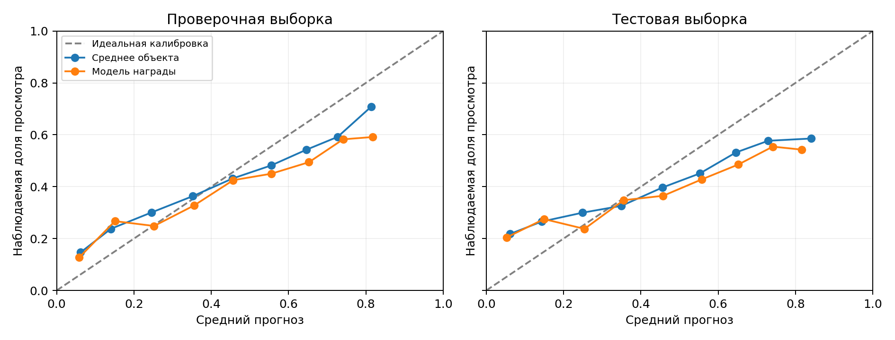
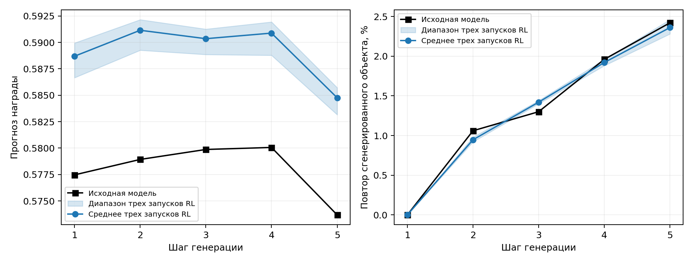
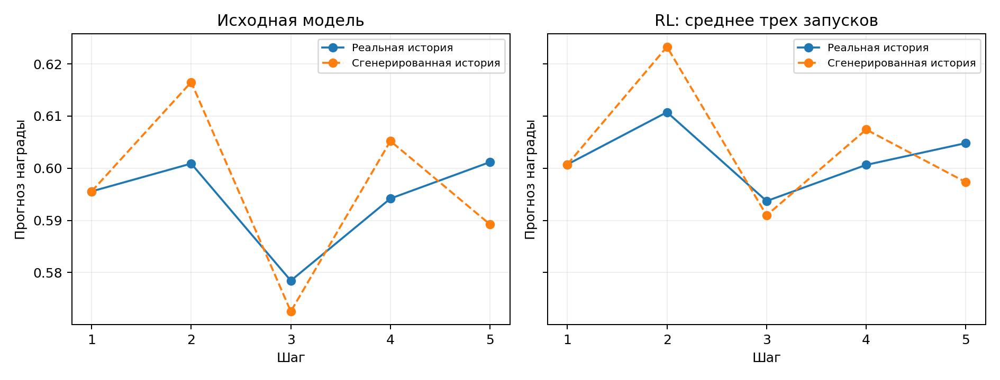

# Эксперименты и выводы

[Обзор](../README.md) · [Метод](method.md) · [Протокол](protocol.md)

Исследование отвечает на три вопроса: можно ли увеличить прогноз награды,
сколько релевантности это стоит и что меняется при генерации нескольких объектов.
Настройки выбираются на проверочной выборке; итоговые состояния затем оцениваются
на тестовой. Сначала рассмотрим выбор компонентов, затем - итоговое сравнение.

## 1. Базовая модель и объем данных

Все значения ниже относятся к проверочной выборке. Сравниваются одинаковые
даты, каталог и отложенные примеры; меняются обучающая часть и размер GPT-2.

| Метод | Обучающих примеров | NDCG@10 | Recall@10 | Покрытие каталога |
| --- | ---: | ---: | ---: | ---: |
| Популярные объекты | - | 0,082585 | 0,1580 | 0,09% |
| Переходы между объектами | - | 0,090100 | 0,1670 | 9,48% |
| GPT-2, размерность 128 | 215 667 | 0,106733 | 0,1878 | 2,63% |
| **GPT-2, размерность 128** | **648 685** | **0,112363** | **0,1986** | **6,15%** |
| GPT-2, размерность 256 | 648 685 | 0,111626 | 0,1958 | 8,34% |

Число готовых префиксов указано для GPT-2. Частотные методы используют
статистики соответствующей обучающей части, без отложенных событий.

Расширение данных дало **+5,27% NDCG** относительно повторно обученной малой
выборки. Увеличение размерности до 256 не показало преимущества в точности,
хотя повысило покрытие. Для следующих этапов выбрана размерность 128,
состояние после 45 612 обновлений. Правила ранней остановки одинаковы,
но число обновлений различается: эффекты данных и вычислений полностью не разделены.
Для исходных GPT-2 использовано одно случайное состояние генератора.

## 2. Насколько надежна модель награды

Нейросетевая модель учитывает историю и кандидата. Для сравнения используются
общее обучающее среднее и сглаженное среднее по объекту.

| Предиктор | RMSE, проверка | RMSE, тест | Корреляция Спирмена, проверка | Корреляция Спирмена, тест |
| --- | ---: | ---: | ---: | ---: |
| **Среднее объекта** | **0,375483** | **0,383043** | **0,314388** | **0,291466** |
| Нейросетевая модель награды | 0,392088 | 0,399714 | 0,279648 | 0,248537 |
| Общее среднее | 0,391737 | 0,389166 | - | - |

Модель награды уступает простому среднему объекта на обеих частях.
Высокие прогнозы переоценены: на тесте в интервале 0,8–0,9 средний прогноз
равен 0,816, а наблюдаемая доля просмотра - 0,543, по 117 целям.
Сравнение обучающих множеств не полностью симметрично; подробности указаны
в [протоколе](protocol.md). Тем не менее, надежность награды - основное
ограничение последующей оптимизации.

Положение ниже диагонали означает завышение прогноза. Эти ошибки измерены
на наблюдавшихся объектах; качество предсказаний для ненаблюдавшихся действий
новой рекомендующей модели неизвестно.

## 3. Какие изменения в RL помогают

Первая серия: семь вариантов, по 2000 обновлений, один случайный запуск.
В таблице относительные изменения к исходной GPT-2 на проверочной выборке.

| Вариант | Изменение NDCG@10 | Изменение прогноза награды |
| --- | ---: | ---: |
| Без KL | −3,86% | +8,83% |
| KL, β=0,1 | −2,77% | +7,89% |
| KL, β=0,3 | −2,15% | +6,29% |
| Штраф известного объекта, β=0,3 | −1,78% | +6,15% |
| Дополнительное предсказание, α=0,1 | −1,63% | +5,18% |
| Опорное значение по другим траекториям, β=0,3 | −3,38% | +8,37% |
| Горизонт 5, β=0,3 | −1,32% | +3,25% |

Без достаточного ограничения модель быстро повышает прогноз, теряя точность.
Штраф известного объекта и дополнительное предсказание смягчают сдвиг
по точечным оценкам.
Горизонт 5 не показал убедительного преимущества по диагностике цепочек.
Опорное значение по другим траекториям повышает прогноз сильнее, но также
сильнее снижает NDCG. У этого варианта четыре траектории на контекст,
поэтому равное число обновлений не означает равного вычислительного бюджета.

### Сохранение релевантности: три случайных запуска

Следующая серия фиксирует β=0,3, горизонт 1 и сравнивает четыре веса
дополнительного предсказания. Каждый вариант обучен по 2500 обновлений
с ключами случайности 42/123/2026. В каждом запуске выбран максимальный
прогноз при проверочном NDCG не ниже исходной GPT-2.

| Вес α | Среднее изменение NDCG | Прирост прогноза, среднее ± стандартное отклонение |
| ---: | ---: | ---: |
| 0 | +0,049% | +0,75 ± 0,91% |
| 0,1 | +0,115% | +1,68 ± 0,93% |
| **0,3** | **+0,054%** | **+3,19 ± 0,57%** |
| 1,0 | +0,412% | +1,15 ± 0,01% |

Основной вариант - α=0,3. Выбранные шаги - 2300/2400/1500, прирост
прогноза - 3,49%/3,55%/2,53%. Это дообученные состояния всех трех запусков.
Сохранение точечной оценки обеспечивается правилом выбора на проверке;
статистическая неухудшаемость из него не следует.

### Отдельный вклад RL

Контроль отключает REINFORCE, оставляя те же предсказание следующего объекта,
KL, исходные веса, случайные состояния и число обновлений.
На одинаковом шаге 2500 получены следующие средние по трем запускам:

| Метод | α | Изменение NDCG, проверка | Изменение прогноза, проверка |
| --- | ---: | ---: | ---: |
| Предсказание + KL | 0,3 | +0,566% | −0,361% |
| RL + предсказание + KL | 0,3 | −0,284% | +3,641% |
| Предсказание + KL | 1,0 | +0,553% | −0,463% |
| RL + предсказание + KL | 1,0 | +0,446% | +1,146% |

Дополнительный рост прогноза не объясняется одним продолжением обучения
по реальным следующим объектам. При этом небольшой рост NDCG после такого
продолжения нельзя приписывать исключительно RL.

## 4. Итоговая оценка на тестовой выборке

Все состояния выбраны заранее; по тесту не меняются пороги, шаги и основной
вариант. Для семейств RL ниже приведены средние трех запусков.
Варианты на шаге 2500 - заранее заданные сравнения с одинаковой длиной обучения.

| Метод | NDCG@10 | Recall@10 | Прогноз награды | Изменение NDCG | Изменение прогноза |
| --- | ---: | ---: | ---: | ---: | ---: |
| Популярные объекты | 0,073661 | 0,1376 | - | −29,56% | - |
| Исходная GPT-2 | 0,104578 | 0,1764 | 0,567302 | - | - |
| **Основной RL, α=0,3, выбранные шаги** | **0,103759** | **0,1756** | **0,584788** | **−0,78%** | **+3,08%** |
| RL, α=0,3, шаг 2500 | 0,103494 | 0,1754 | 0,587031 | −1,04% | +3,48% |
| RL, α=1,0, шаг 2500 | 0,104595 | 0,176667 | 0,573427 | +0,02% | +1,08% |
| RL без дополнительного предсказания, шаг 2500 | 0,100985 | 0,1726 | 0,605632 | −3,44% | +6,76% |
| Переранжирование, λ=0,25 | 0,103186 | 0,1750 | 0,581413 | −1,33% | +2,49% |
| Переранжирование, λ=0,5 | 0,102635 | 0,1752 | 0,595374 | −1,86% | +4,95% |
| Переранжирование, λ=1,25 | 0,097078 | 0,1690 | 0,628540 | −7,17% | +10,79% |

Рост прогноза переносится на тест, но сохранение релевантности на проверке
не гарантирует ее сохранения на другой временной части. При α=1,0 сдвиг
меньше: обе средние точечные метрики немного выше исходных, однако изменение
NDCG на 0,02% не доказывает улучшения. Основной выбор по тесту не заменяется.
Выбранные основные состояния лежали близко к проверочной границе NDCG:
их средний запас составлял лишь 0,054%. Правило отбора по конечной выборке
не задает такой же границы для других пользователей и контекстов.

Переранжирование остается сильным сравнением без обучения. При малом λ
основной RL имеет лучшие средние точечные оценки обеих метрик; при большем λ
переранжирование дает больше награды ценой большей потери NDCG.
Полное превосходство одного метода по непрерывной границе компромисса
не установлено: проверена конечная сетка коэффициентов.

### Разброс и интервалы

| Случайный запуск | Шаг | NDCG@10 | Прогноз награды | Прирост прогноза |
| ---: | ---: | ---: | ---: | ---: |
| 42 | 2300 | 0,103540 | 0,586275 | +3,34% |
| 123 | 2400 | 0,103543 | 0,586706 | +3,42% |
| 2026 | 1500 | 0,104194 | 0,581383 | +2,48% |

Прирост прогноза - **3,08 ± 0,52%**. У каждого запуска прогноз выше,
а точечный NDCG ниже исходного. Если усреднить три политики внутри пользователя,
парная разность NDCG равна **−0,000819**, 95%-й интервал
**[−0,002094; +0,000523]**. Для прогноза награды разность **+0,017485**,
интервал **[+0,016740; +0,018221]**. Нижняя граница NDCG допускает около
2% относительной потери. Статистическая неухудшаемость не доказана.

Отдельное сопоставление с контролем для ключа 42, α=0,3, шага 2500
дает разность «RL минус предсказание + KL» **+0,021885** по прогнозу,
интервал [+0,021052; +0,022741], и **−0,002410** по NDCG,
интервал [−0,003849; −0,001002]. Это готовое сравнение одного случайного
запуска, не среднее трех контролей на тесте.

## 5. Поведение и эксплуатация награды

| Показатель на тесте | Исходная GPT-2 | Основной RL, среднее |
| --- | ---: | ---: |
| Покрытие каталога | 6,403% | 6,409% |
| Известные объекты в первых десяти | 8,474% | 8,734% |
| Доля 1% самых популярных объектов | 78,662% | 78,736% |
| Пересечение списков соседних пар пользователей | 33,585% | 33,686% |

Признаков дополнительного обвала покрытия нет; высокая исходная концентрация
популярных объектов сохраняется. RL немного чаще предлагает знакомые объекты.
Это изменение поведения согласуется с риском эксплуатации ошибок награды,
но не доказывает конкретный механизм такой эксплуатации.

Наблюдаемый конфликт - прогноз награды растет, а релевантность может снижаться.
Вместе с переоценкой высоких прогнозов RM это ограничивает интерпретацию успеха
оптимизации. Предпочтение коротких фильмов не установлено: `total_dur`
отражает фактическое взаимодействие, а не известную заранее длительность кандидата.

## 6. Пять шагов и сдвиг контекста

На всех 5000 тестовых контекстах средний прогноз по пяти сгенерированным
объектам равен **0,589167** у основного RL против **0,578001** у исходной модели.
На пятом шаге текущий ID повторяет один из предыдущих в **2,36%** случаев
у RL и **2,42%** у исходной модели. Рост данной меры повторов не наблюдается.

Заливка - диапазон трех случайных запусков, не доверительный интервал.
Каждая рекомендация добавляется в контекст как будто просмотренная,
хотя пользователь мог ее проигнорировать.

Для **192 пользователей** с пятью пригодными реальными продолжениями
сравниваются два режима: обновлять контекст наблюдаемой историей или добавлять
сгенерированные ID. Стартовые контексты одинаковы.

На пятом шаге прогноз исходной модели равен 0,601184 на реальной истории
и 0,589236 на сгенерированной. У основного RL средние значения - 0,604819
и 0,597336. На втором шаге сгенерированная история, напротив, дает более
высокий прогноз. Эффект не монотонен: синтетический контекст меняет дальнейшие
рекомендации и оценку награды, а не измеряет фактическую последовательность откликов.
Подгруппа отобрана по наличию продолжений; это активная аудитория, и пригодные
цели не обязательно соответствуют пяти соседним исходным событиям.
Доверие к прогнозу на таких контекстах дополнительно ограничено тем,
что модель награды обучалась на наблюдаемых историях, а не на вымышленных
просмотрах сгенерированных рекомендаций.

## 7. Как приблизиться к долгосрочной цели

Возможная метка - наличие следующего взаимодействия в течение семи дней
или число активных дней за этот срок. Метка рассчитывается только при полном
окне наблюдения внутри соответствующей временной части; иначе правый край
данных ошибочно превращается в отсутствие возврата. Можно объединить ее
с долей просмотра и штрафом повторов, предварительно проверив каждую компоненту.

На исторических данных можно оценить предсказание активности, устойчивость
меток и компромисс метрик. Такой сигнал зависит от прежней рекомендательной
политики и исходной активности пользователя. Он не устанавливает причинный
эффект новой рекомендации. Для вывода об удержании нужны полноценные журналы
показов и реакций, проверенная модель поведения и онлайн-эксперимент.

## Выводы и границы применимости

1. Компактная GPT-2 превосходит популярность на обеих отложенных частях.
   Расширение обучения помогло; увеличение размерности не дало подтвержденного
   выигрыша точности.
2. RL устойчиво повышает прогноз награды. Дополнительное предсказание
   следующего объекта регулирует компромисс с релевантностью; проверочное
   ограничение не гарантирует сохранения NDCG на тесте.
3. Улучшение самой удовлетворенности не установлено: модель награды уступает
   простому ориентиру и переоценивает высокие прогнозы. Оптимизация слабой цели
   не делает ее надежной мерой пользовательского опыта.
4. Переранжирование остается сильной альтернативой. Многошаговая генерация
   полезна для диагностики, но требует отдельной модели реального отклика.

Главные ограничения: агрегированные даты и большая доля `UNK`, оценка только
по известным каталогу объектам и отобранным пользователям, одна исходная GPT-2,
общая RM у всех запусков и ранее просмотренная тестовая часть.
Интервалы условны на фиксированных весах, без поправки на множество сравнений.
Направления улучшения - более информативная история, независимая проверка
награды и данные с показами; эти изменения требуют отдельного эксперимента.

Точные числа: [таблицы](../results/tables/), [описание результатов](../results/README.md).
